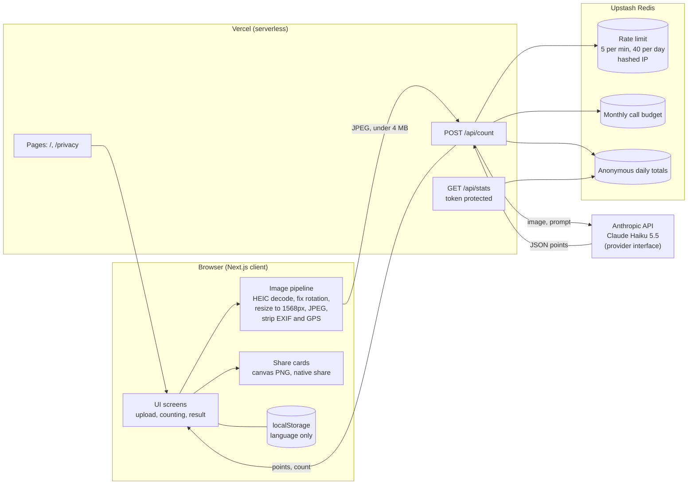
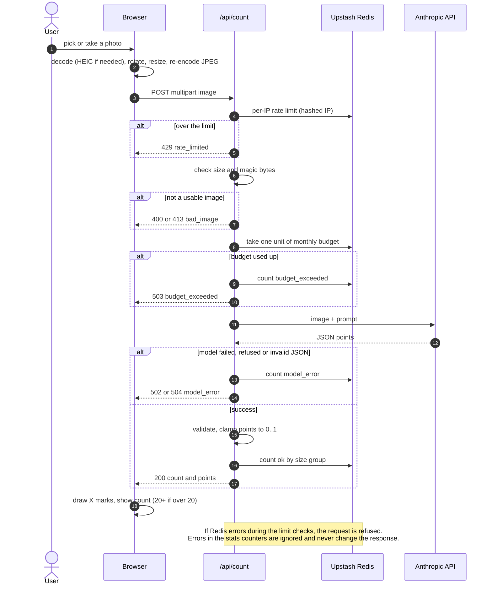
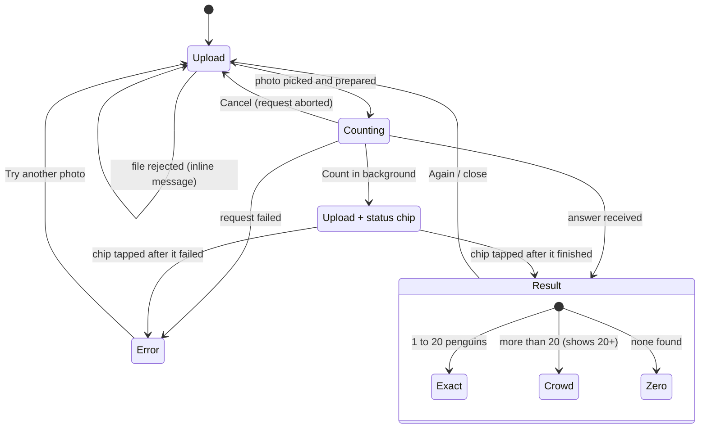

# Find Me Penguin · ペンギン探そう

Upload or take a photo and the app counts the penguins, marking each one with an **X**. Real, cartoon or toy penguins all count. Shareable result cards, English and Japanese.

Next.js (App Router) on Vercel. A vision model (Anthropic Haiku by default, behind a provider interface) does the counting. Photos are resized in the browser, sent once, and never stored.

## How it works

### Architecture

Photos are prepared in the browser, counted by a vision model behind a thin server route, and never stored. Redis holds only counters.



### One count, step by step

The order matters: cheap checks run first, and the monthly budget is spent only after a photo passes validation, so bad uploads cost nothing.



### Screen flow

"Count in background" returns to the upload screen while the request keeps running. A status chip shows progress and becomes tappable once the result (or an error) is ready.



### Code map

| Area | Where |
|---|---|
| Screens and state machine | `src/components/`, `src/lib/flow.ts` |
| Browser image pipeline (HEIC, rotation, resize) | `src/lib/image-pipeline.ts`, `src/lib/browser-image.ts` |
| Counting route and its checks | `src/app/api/count/route.ts`, `src/lib/count-handler.ts` |
| Model providers (swap models here) | `src/lib/providers/` (`PenguinProvider` interface, Anthropic adapter, mock) |
| Prompt | `src/lib/providers/prompt.ts` |
| Output validation | `src/lib/schema.ts` |
| Rate limit and monthly budget | `src/lib/limits.ts` |
| Anonymous usage counters | `src/lib/stats.ts`, `src/lib/stats-handler.ts` |
| Share cards | `src/lib/share-card.ts`, `src/lib/card-layout.ts`, `src/components/ShareCards.tsx` |
| Translations (EN and JA) | `src/lib/i18n.ts` |

## Develop

```bash
npm install
npm run dev          # uses the mock provider (3 fixed points) when PROVIDER is unset
npm test             # unit tests
npm run typecheck
npm run lint
```

Copy `.env.example` to `.env.local` and fill it in to use the real model (`PROVIDER=anthropic`).

## Other scripts

```bash
npm run eval                  # score the labeled photos with the mock (free)
npm run eval -- --live        # score with the real model (spends API money)
npm run smoke -- https://URL  # check a deployed copy
```

The eval photos are not in git (they include private and third-party images). `eval/manifest.json` lists the files and true counts; put the photos in `eval/photos/`.

## Privacy and accessibility

- `/privacy` explains exactly what is and isn't kept (also in Japanese). Keep it in step with the code if behaviour changes.
- Usage is measured with anonymous daily counters in Redis (`src/lib/stats.ts`), viewable at `/api/stats` when `STATS_TOKEN` is set. No cookies, no third-party analytics.
- Screens were checked with axe-core (WCAG 2.2 AA rules) and keyboard navigation; colour contrast is locked in by `src/lib/contrast.test.ts`.

## Deploying

See [DEPLOY.md](./DEPLOY.md). In production the counting route refuses to run unless the Upstash rate-limit variables are set, so the paid model can never run unguarded.

## Design and decisions

See [SPEC.md](./SPEC.md).
